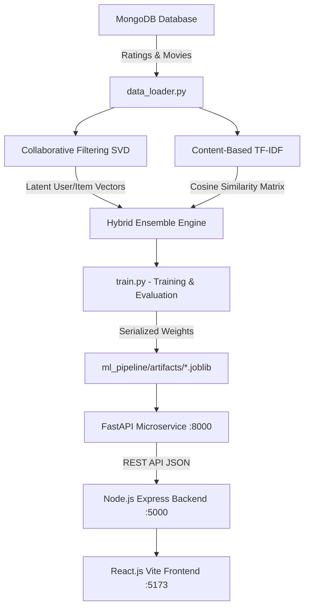

# CineAI - Python Machine Learning Pipeline

This module implements a production-grade **Machine Learning Recommendation Pipeline** using **Scikit-Learn**, **NumPy**, **Pandas**, **SciPy**, and **FastAPI**, serving personalized movie recommendations to the CineAI MERN stack web application.

---

## 🏛️ System Architecture



---

## 🔬 Mathematical Formulations

### 1. Collaborative Filtering (Matrix Factorization via TruncatedSVD)
The user-item interaction matrix $R \in \mathbb{R}^{m \times n}$ is decomposed into lower-rank latent factor representations:
$$\hat{R} = U \cdot \Sigma \cdot V^T$$
Where:
* $U \in \mathbb{R}^{m \times k}$: Latent user taste preferences.
* $\Sigma \in \mathbb{R}^{k \times k}$: Singular values (strength of each latent factor).
* $V^T \in \mathbb{R}^{k \times n}$: Latent movie characteristics.
* Predicted rating score $\hat{r}_{ui} = \vec{u}_u \cdot \vec{v}_i$.

### 2. Content-Based Filtering (TF-IDF & Cosine Similarity)
Movie metadata (genres, directors, cast, and overview) are transformed into TF-IDF feature vectors:
$$\text{TF-IDF}(t, d, D) = \text{TF}(t, d) \times \log\left(\frac{|D|}{1 + |\{d \in D : t \in d\}|}\right)$$

User profile vectors $\vec{p}_{user}$ are constructed from positive ratings ($r \ge 3$), watchlists, and preferred genres. The similarity to candidate movies is computed via Cosine Similarity:
$$\text{Sim}(\vec{p}_{user}, \vec{m}_j) = \frac{\vec{p}_{user} \cdot \vec{m}_j}{\|\vec{p}_{user}\| \|\vec{m}_j\|}$$

### 3. Hybrid Ensemble Fusion
Final recommendation rankings blend collaborative, content, and baseline ratings:
$$\text{Score}_{final} = w_{collab} \cdot \hat{r}_{collab} + w_{content} \cdot \text{Sim}_{content} + w_{base} \cdot \text{Baseline}$$
*(Default weights: $w_{collab} = 0.45$, $w_{content} = 0.40$, $w_{base} = 0.15$)*

---

## 🚀 Quickstart Guide

### 1. Install Dependencies
```bash
pip install -r ml_pipeline/requirements.txt
```

### 2. Train the Model
Extracts the latest movie interactions from MongoDB, fits the SVD and TF-IDF models, and saves serialized artifacts to `ml_pipeline/artifacts/`:
```bash
python -m ml_pipeline.train
```

### 3. Evaluate the Model Benchmark
Evaluates validation RMSE, MAE, feature matrix sparsity, and inference latency over 50 iterations:
```bash
python -m ml_pipeline.evaluate
```

### 4. Run the Python Inference Microservice
Starts the FastAPI service on port 8000:
```bash
python -m uvicorn ml_pipeline.service:app --port 8000
```
Interactive Swagger API documentation: [http://127.0.0.1:8000/docs](http://127.0.0.1:8000/docs)

---

## 🔌 API Endpoints

* `GET /health` – Check model health, version, training timestamp, and indexed catalog size.
* `GET /recommend/{user_id}?limit=10` – Returns ranked recommendations with confidence scores and Explainable AI (XAI) rationale.
* `POST /retrain` – Triggers the training pipeline and hot-reloads models in memory.

---

## 📁 Directory Structure
```
ml_pipeline/
├── artifacts/                  # Serialized .joblib models and metadata
│   ├── collaborative_svd.joblib
│   ├── content_tfidf.joblib
│   ├── movie_catalog.joblib
│   └── model_metadata.json
├── models/
│   ├── collaborative_model.py # Matrix Factorization / TruncatedSVD
│   ├── content_model.py       # TF-IDF Vectorizer & Cosine Similarity
│   └── hybrid_engine.py       # Multi-model Ensemble & Explainability
├── config.py                  # Hyperparameters and paths
├── data_loader.py             # MongoDB extraction & preprocessing
├── train.py                   # Model training and artifact serialization
├── evaluate.py                # Academic / industrial evaluation metrics
├── service.py                 # FastAPI microservice
└── requirements.txt           # Python dependencies
```
